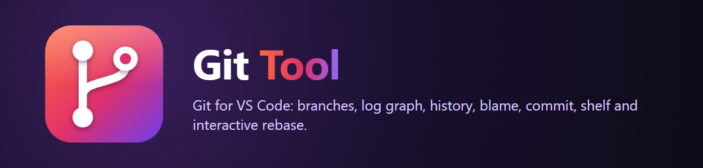
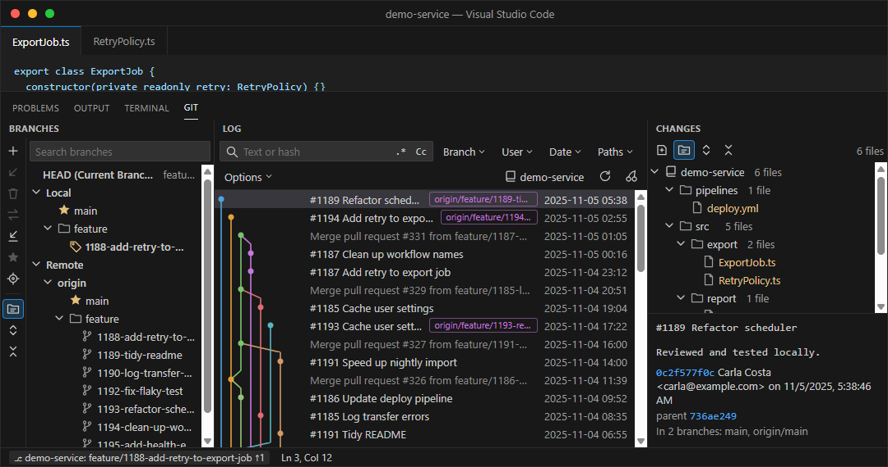
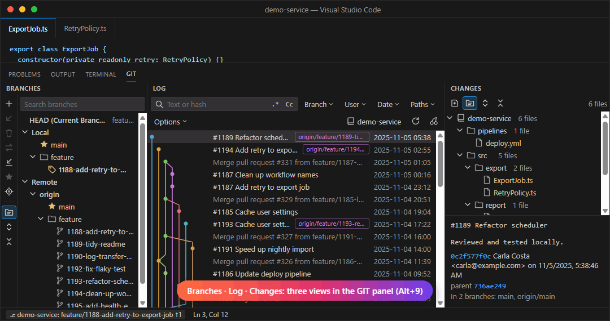
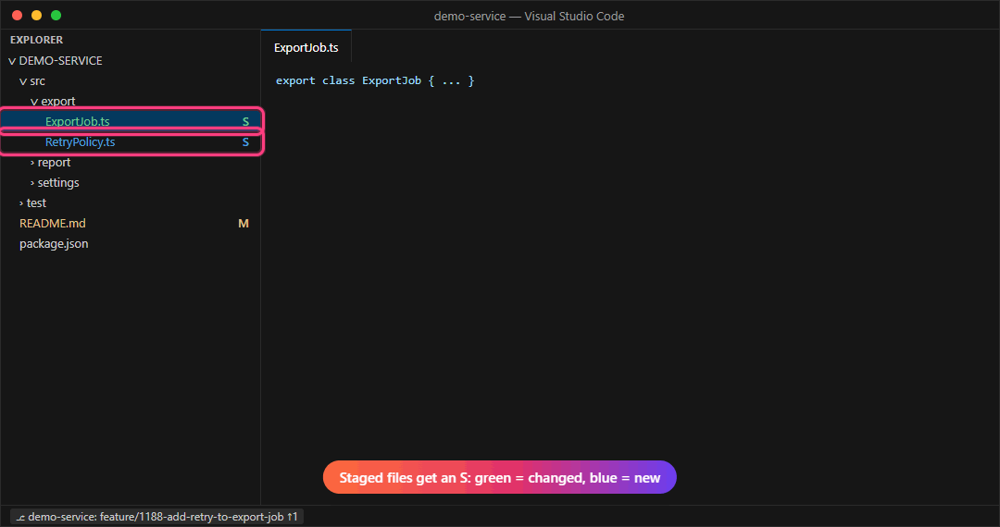
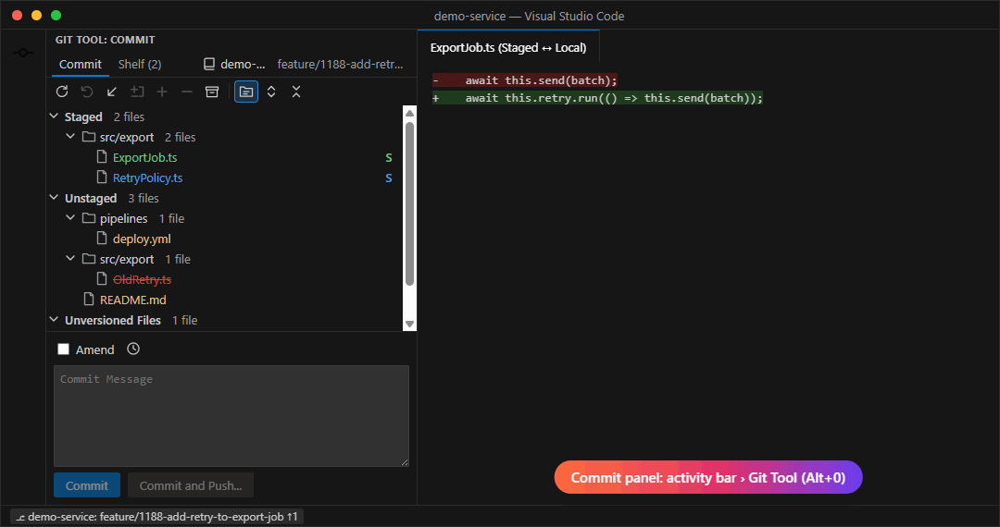
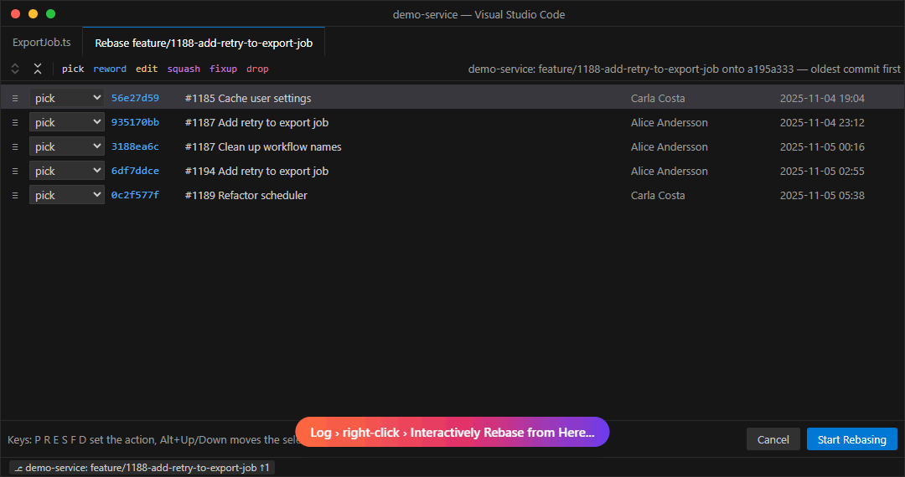

<p align="center">
  
</p>

<p align="center">
  <b>A complete Git workbench inside VS Code.</b><br>
  Branches, a real commit graph, file history, blame, staging, shelves and interactive rebase, without leaving the editor.
</p>

<p align="center">
  
  
  
</p>

---

## ✨ Highlights

| | |
|---|---|
| 🌳 **Branches** | Local, remote and tags in a tree, favourites on top, update, compare, delete and fetch with one click. |
| 📜 **Log with graph** | Coloured commit graph, branch and tag labels, filters for text/hash, branch, user, date and paths. |
| 🧩 **Changes** | Files of the selected commit(s) as a tree; click a file for its diff. |
| 🖱️ **Multi-select** | Ctrl/Shift+click commits, then cherry-pick, revert, squash, drop, compare or create a patch. |
| 🔁 **Interactive rebase** | Reorder, reword, squash, fixup, edit or drop commits in a visual editor. |
| ✅ **Commit & Shelf** | Staged / Unstaged / Unversioned lists, Amend, message history, Commit and Push, stashes as shelves. |
| 🔍 **Git right-click menu** | History, blame, compare with revision/branch/staged, rollback, push, pull, merge, rebase on any file or folder. |
| 🟢🔵 **Staged badges** | Staged files get an **S**: green for changed files, blue for new files. |

<p align="center">
  
</p>

---

## 🧭 Where to find everything

| Part | Where | Shortcut |
|---|---|---|
| **Branches · Log · Changes** | Bottom panel, tab **GIT** (three views side by side) | `Alt+9` |
| **Commit · Shelf** | Activity bar, **Git Tool** icon | `Alt+0` |
| **Git menu** | Right-click a file or folder in the Explorer, the editor or an editor tab › **Git** | |
| **Branch popup** | Status bar, left: `⎇ repo: branch ↑1 ↓2` | |
| **File history** | Git › **Show History** (opens in an editor tab) | |
| **Interactive rebase** | Log › right-click a commit › **Interactively Rebase from Here...** | |

> 💡 Each of the three bottom views can be resized, moved or hidden: right-click its header and choose **Hide**.

---

## 📜 Branches · Log · Changes

<p align="center"></p>

- **Click a branch** to filter the log to that branch. The target button jumps to the branch head.
- **Branch toolbar:** new branch, update selected, delete, compare with current, fetch, favourite, group by directory, expand / collapse.
- **Branch right-click:** checkout, new branch from here, checkout and rebase onto current, compare, diff with working tree, rebase, merge, push, rename, delete.
- **Commit list:** merges are greyed out, your own commits are bold, labels such as `origin & main` show where branches point.
- **Keyboard:** `↑ ↓` move, `Shift+↑ ↓` extend, `Ctrl+A` select all, `← →` child / parent commit.
- **Inline dropdown filters:** Branch, User, Date, Paths and Options open inside the Git view. Paths lists repository roots with checkboxes, search, Select All and Apply. All repositories are included by default.
- **Options:** By Commit Date or Topologically, First Parent, No Merges, and compact repository histories or all repository lanes.
- **Graph:** circles are commits; lines connect their parents. In compact mode each repository reuses the graph area; arrowheads mark history interrupted by other repository rows. Click a graph to focus its repository, then clear Paths to restore all repositories. Independent repositories are never shown as if they share a parent.
- **Persistent cache:** history queries, branch state and repository discovery are saved in VS Code's extension storage, outside your repositories. Reopening restores the last log immediately, then checks refs in the background. Unchanged history has no age-based expiry; a week-old cache remains reusable. New commits, moved/deleted refs and topology changes refresh the affected data. Working file edits do not rebuild commit history. Options → **Rebuild selected histories** explicitly refreshes cached history. Git Tool output reports restored-view time and the number of Git history commands needed.
- **Several commits selected:** Changes shows their combined changes.

### Commit right-click menu

| One commit | Several commits |
|---|---|
| Copy Revision Number · Create Patch · Cherry-Pick | Copy all hashes · one patch file · cherry-pick oldest first |
| Checkout Revision · Show Repository at Revision · Show All Changes · Compare with Local | **Compare Versions** (exactly two) |
| Reset Current Branch to Here · Revert Commit · Undo Commit | **Revert Commits** |
| Edit Commit Message · **Fixup** · **Squash Into** · Drop · **Interactively Rebase from Here** · Push All up to Here | **Squash Commits** · **Drop Commits** |
| New Branch · New Tag · Go to Child / Parent Commit | |

> **Fixup** and **Squash Into** fold your *staged* changes into an older commit; Squash Into also lets you edit the message.

---

## 🔍 Git menu on files and folders

<p align="center"></p>

- **Annotate with Git Blame** – author and date in the gutter, newer lines brighter; hover for the commit and a link into the log.
- **Show Diff · Compare with Revision · Compare with Branch or Tag** – for single files and for whole folders (one multi-file diff).
- **Show History** – the log for a file or folder, following renames. Select lines in the editor for **Show History for Selection**.
- **Show Staged Version · Compare with Staged · Compare HEAD, Staged and Local.**
- **Rollback** – back to HEAD; newly added files are only un-staged and stay on disk.
- **Push** lists the outgoing commits first (with *force with lease* as an option). **Pull** remembers merge / rebase / fast-forward.
- **Branches...** opens a searchable popup. **Smart Checkout** stashes, switches and unstashes when local changes are in the way.
- **Stash / Unstash · Reset HEAD · New Tag · Manage Remotes · Clone.**

---

## ✅ Commit and 📦 Shelf

<p align="center"></p>

- **Staged**, **Unstaged**, **Unversioned** and **Merge Conflicts**, grouped by directory.
- Click a file for its diff; hover for **Stage**, **Unstage**, **Rollback** and **Open**. Right-click for shelve, delete, add to `.gitignore` and history.
- **Commit** commits the staged files. With nothing staged the button becomes **Commit All**.
- **Amend** loads the last message, 🕘 opens your message history, `Ctrl+Enter` commits, **Commit and Push...** does both.
- **Shelf** lists your stashes. Expand one to diff its files, then Unshelve, Pop or Delete.
- Staged files get an **S** badge in the Explorer and on editor tabs: 🟢 changed file, 🔵 new file.

---

## 🔁 Interactive rebase

<p align="center"></p>

- Open it from **Log › right-click › Interactively Rebase from Here...**; commits are listed oldest first.
- Actions **pick, reword, edit, squash, fixup, drop**, also with the keys `P R E S F D`.
- Reorder with drag and drop or `Alt+↑` / `Alt+↓`. **reword** edits the message directly in the list.
- Local changes are stashed automatically. If the rebase stops (conflict or *edit*), continue or abort from **Git › Rebase...**.
- You get a warning when the commits are already pushed, because the branch then needs a force push.

---

## ⚙️ Settings

| Setting | Default | |
|---|---|---|
| `vscgit.followActiveEditor` | `true` | Switch to the repository of the active editor. |
| `vscgit.logMaxCount` | `1000` | Commits loaded at a time (*Load more* at the bottom). |
| `vscgit.fetchPrune` | `true` | Prune deleted remote branches when fetching. |
| `vscgit.repositoryScanDepth` | `1` | Folder levels below each workspace folder scanned for repositories. |

The badge colours can be changed in `workbench.colorCustomizations`:

```jsonc
"workbench.colorCustomizations": {
  "vscgit.stagedModifiedForeground": "#73C991",
  "vscgit.stagedAddedForeground": "#4FA3E0"
}
```

If VS Code's built-in Git colours win over the badges, set `"git.decorations.enabled": false`.

---

## 📝 Good to know

- Everything runs through the `git` command line, so your credentials, hooks and config apply as usual.
- Several repositories in one workspace are supported: switch with the repository button in each view or **Git Tool: Select Repository...**.
- History rewriting (edit message, fixup, squash into, squash, drop, interactive rebase) works on the current branch when there are no merge commits between the selected commit and HEAD.

## 🛠️ Build

```powershell
npm install
npm run package                                   # compile, test and build the .vsix
code --install-extension gittoolvsc-0.1.0.vsix --force
```

The animations above are recorded from the real view code with made-up demo data (`scripts/readme/`); `node scripts/readme/make-gifs.mjs` turns the frames into GIFs.
